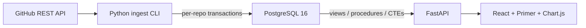
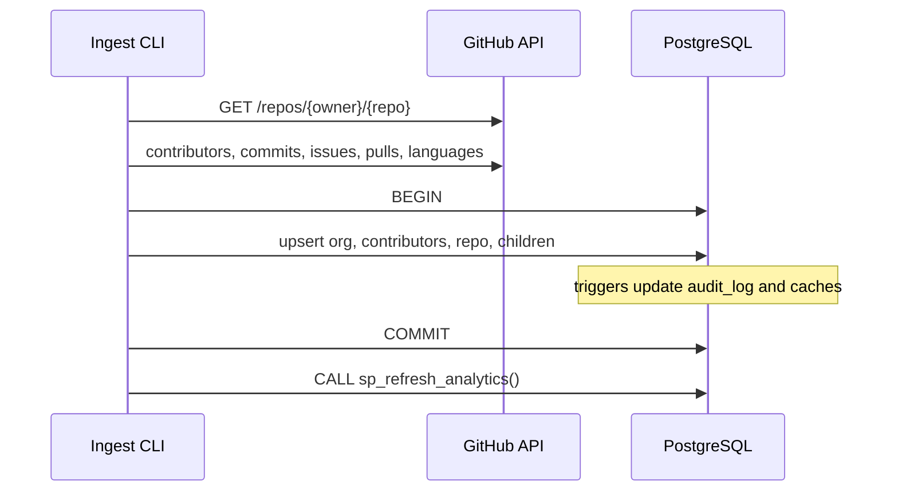

# Architecture

## System overview

## Layers

1. **Ingest** ([backend/app/services/ingest.py](../backend/app/services/ingest.py)) — fetches repo metadata, contributors, commits, issues, PRs, languages; writes inside `conn.transaction()` so a failed repo rolls back cleanly.
2. **Database** (`sql/`) — normalized schema, indexes, triggers (audit + denormalized caches), views for dashboards, stored procedures for health/abandoned refresh, recursive functions for fork trees and commit ancestry.
3. **API** ([backend/app/routers/api.py](../backend/app/routers/api.py)) — thin FastAPI layer that `SELECT`s from views / calls SQL functions. Analytics are not reimplemented in Python.
4. **UI** (`frontend/`) — GitHub-like Primer React shell: Explore marketplace, search, compare, orgs, people, insights.

## Data flow (one repository sync)

## Why SQL stays central

Course requirements (joins, windows, recursive CTEs, procedures, triggers, transactions, indexes) are exercised on real GitHub-shaped data and exposed through stable view contracts so the frontend never embeds scoring logic.
