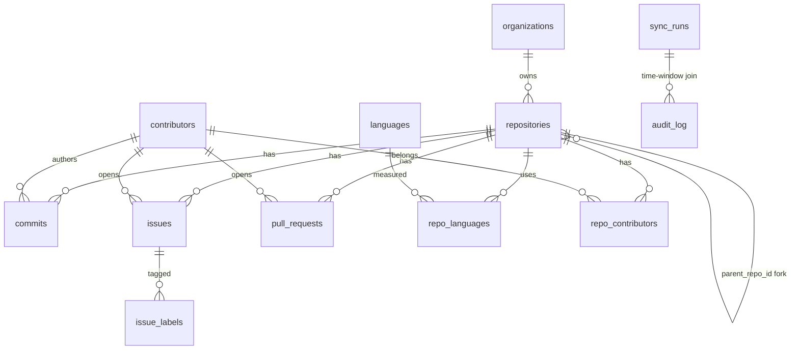

# Entity-relationship diagram

## Tables ([sql/schema.sql](../sql/schema.sql))

| Table | Role |
|---|---|
| `organizations` | GitHub orgs |
| `contributors` | Users/bots |
| `repositories` | Repos; `parent_repo_id` for forks; `health_score`, `is_abandoned` |
| `commits` | SHA + `parent_sha` ancestry |
| `issues` / `issue_labels` | Issues (PRs flagged via `is_pull_request`) + labels |
| `pull_requests` | PR merge stats |
| `languages` / `repo_languages` | Language bytes + share |
| `repo_contributors` | Contribution junction |
| `sync_runs` | Ingest run log |
| `audit_log` | Trigger-written change history |

Primary keys use GitHub IDs where possible so re-syncs upsert idempotently.
